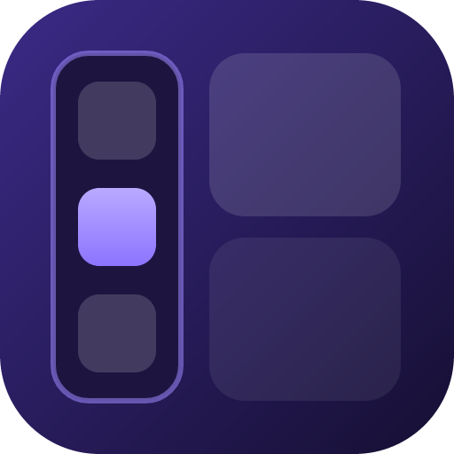
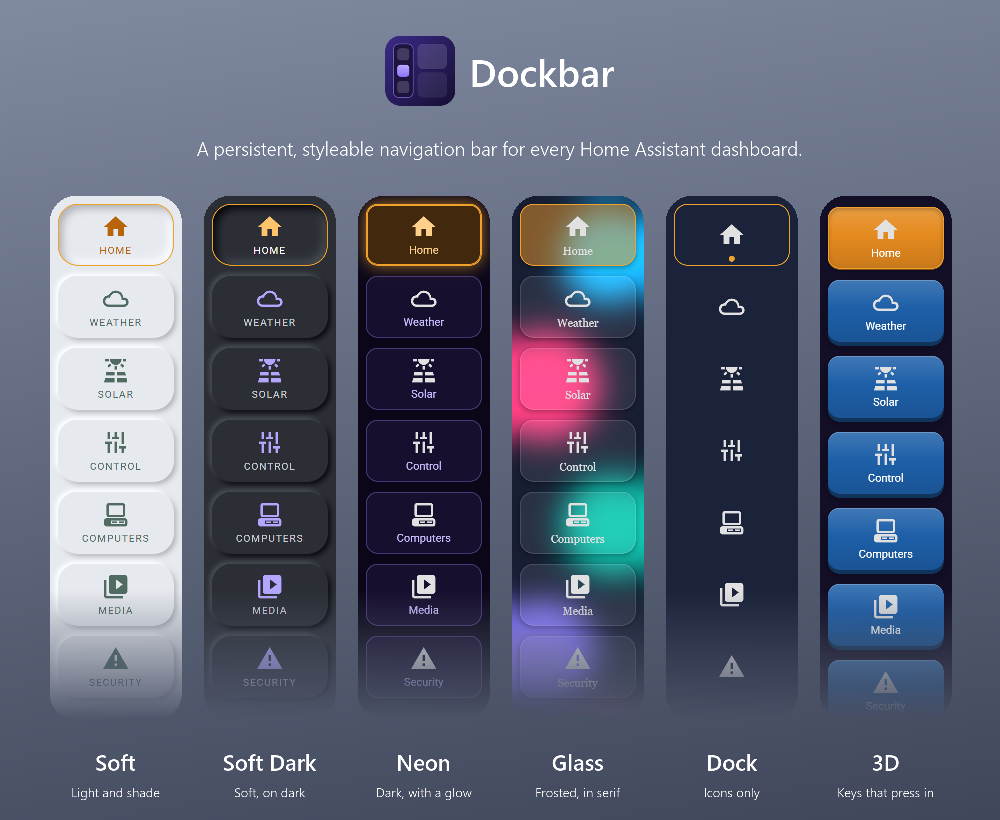
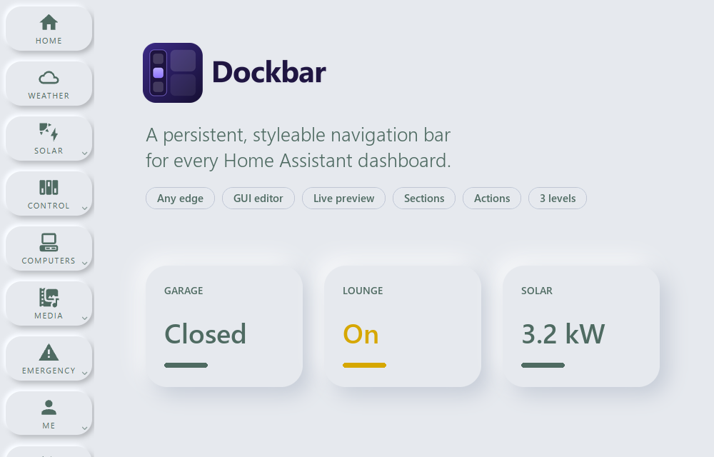
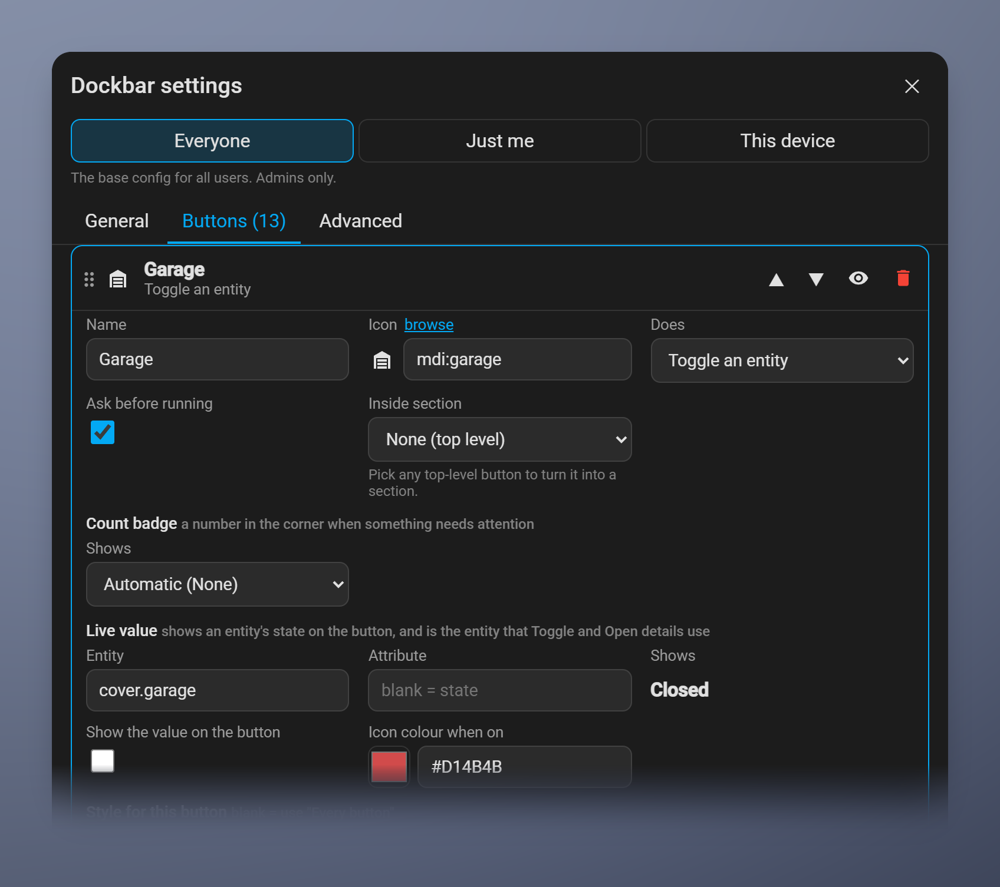
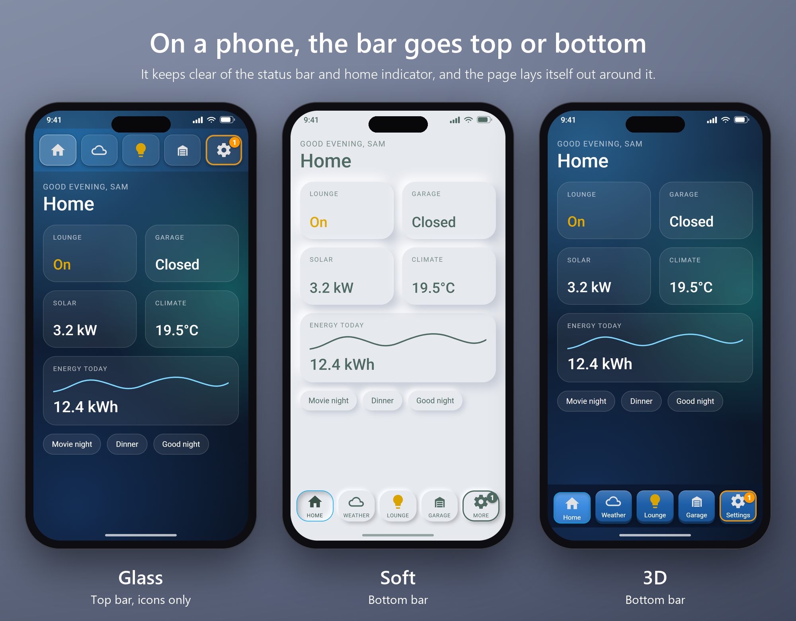
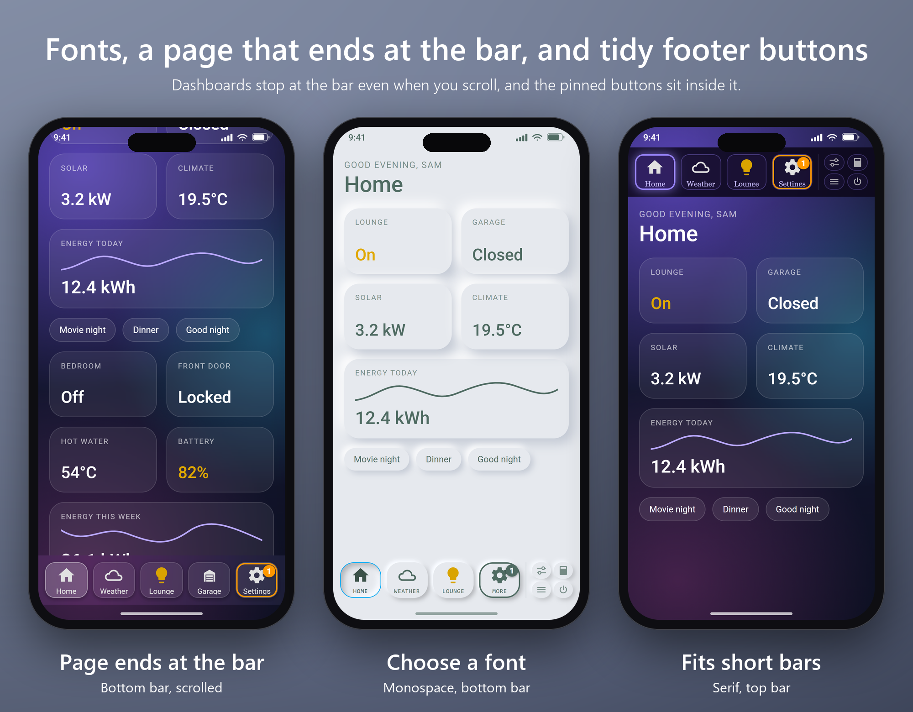
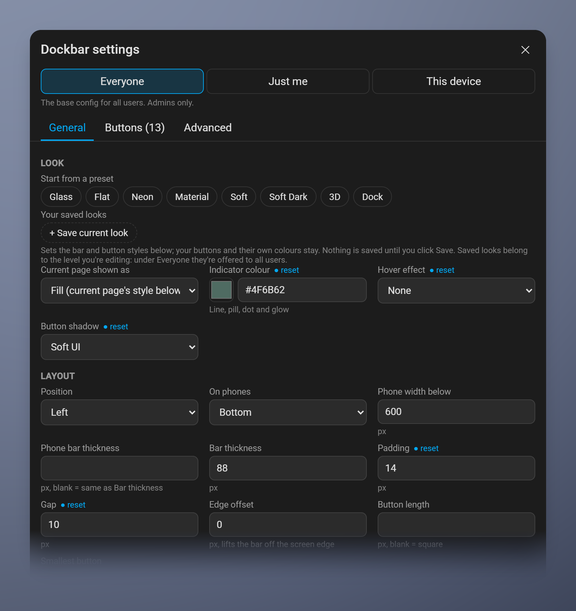
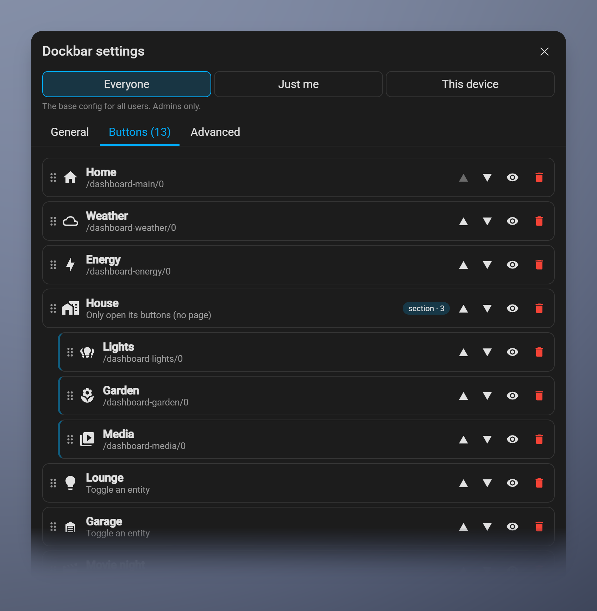

  

<h1 align="center">Dockbar</h1>

<h3 align="center">A navigation bar for every Home Assistant dashboard. Put it on any edge, give it any look, and make its buttons do things.</h3>

  
  
  
  

  

  <a href="#features">Features</a> ·
  <a href="#install">Install</a> ·
  <a href="#get-started">Get started</a> ·
  <a href="#guides">Guides</a>

---

## What is Dockbar?

The sidebar and header in Home Assistant (HA) are small, fixed and hard to style. **Dockbar adds a navigation bar of your own** that stays in place on every dashboard, so you can move around your home without hunting for the menu. Choose where it sits, how it looks, and what each button does.

It isn't a card you add to each dashboard. It loads once and works everywhere, and it can tuck Home Assistant's own sidebar and header out of the way.

  

## Features

### 🎨 Make it yours

Pick a look with one click, then change anything you like.

| Preset | Look |
|---|---|
| **Glass** | See-through and frosted, with soft edges, lifts on hover |
| **Flat** | Solid colours, no borders, current page filled with your theme colour |
| **Neon** | Dark with a coloured glow |
| **Material** | Clean, with a pill behind the current page's icon |
| **Soft** | Neumorphism: light grey, soft light and shade, current page pressed in |
| **Soft Dark** | Soft UI on dark grey with purple accents |
| **3D** | Raised keys that press in; the current page stays pressed |
| **Dock** | Icons only, growing on hover, a dot under the current page |

- Choose how the current page is marked (fill, line, pill, dot or glow), the hover effect and the button shadow.
- Set colours, corners, fonts and label styles for every button, or for just one. Names can be turned off for an icons-only bar.
- Save your own looks under a name, and offer them to everyone or keep them to yourself.
- Add your own CSS for anything else.

### 🔘 Buttons that do things

A button can do more than open a page. Toggle a light, open the garage door, run a scene, or run any Home Assistant action, with an optional "ask first" for buttons you could press by accident.

  

- **Toggle, run an action, or open details.** Actions run as the signed-in person, so Home Assistant's own permissions always apply.
- **Icons that show state.** The icon can turn yellow while a light is on, or red while the garage is open.
- **Live values.** Show a sensor's reading (for example solar power) under a button's name, formatted the way Home Assistant formats it.
- **Count badges.** Pending updates, repairs and unread notifications show as a number in the corner, like Home Assistant's own sidebar.

### 📱 Made for phones

On a small screen the bar can move to the top or bottom, with its own size, or hide so Home Assistant's own menu comes back. It keeps clear of the status bar and home indicator, and the page lays itself out around it.

- **Icons only** when space is tight: turn the names off.
- **Your own font** for the whole bar, or for a single button.
- **The page can end at the bar** instead of scrolling under it (experimental).
- **Lift the bar clear** of a phone's own navigation bar with an edge offset.

  

  

### 🗂️ Stay organised

- **Sections.** Group buttons under one that opens in place, like folders. A closed section adds up its buttons' badges.
- **New dashboards appear by themselves.** Turn on one setting and a button for each dashboard you create is added to the end of the bar.
- **Three levels.** Set the bar for **everyone**, **just for you**, or **just for this device**, so a wall tablet can have its own layout.
- **Hide it where you don't want it.** Per dashboard (for a kiosk view), per device, or everywhere with a switch you can use in automations.
- **Kiosk-friendly.** With the Settings button hidden, hold a finger on the bar for two seconds to open the settings.

### ⚙️ Easy to set up

Everything is in a settings dialog with a live preview, or in YAML if you prefer. Nothing is saved until you click Save.

  

- **Works out of the box.** On first install the bar copies your Home Assistant sidebar, in your order.
- **Searchable pickers.** Type a few words to find an entity, action or page. "kitchen light" finds `light.kitchen_ceiling`.
- **Drag to reorder**, hide or delete buttons, and import buttons from YAML.
- **Reset when you want a fresh start:** buttons, look or everything, at any level, with a warning first and a preview before anything changes.

  

### 🏠 Fits into Home Assistant

- It can hide Home Assistant's sidebar and dashboard header, each on its own setting, and it keeps the Menu button to bring the sidebar back.
- It follows your theme by default.
- It has a switch (`switch.dockbar`) and can be disabled or enabled from **Settings → Devices & services** without a restart.

> A check runs every night against Home Assistant's beta and development builds, so a change that breaks Dockbar shows up before the release does.

## Install

Dockbar is in the HACS default store, so there's no YAML to edit.

### HACS (recommended)

1. In HACS, search for **Dockbar**, download it and restart Home Assistant.
2. Go to **Settings → Devices & services → Add integration → Dockbar.** The bar appears straight away, already filled with your sidebar: every dashboard and panel in your order, then Notifications, Settings and Profile.

> **Bar not showing?** Add `?dockbar=on` to any Home Assistant address (for example `http://homeassistant.local:8123/?dockbar=on`) and reload. It clears the "off" settings this browser may have kept from an earlier install or from the Turn off button.

Already installed it as a custom repository? It keeps updating as before.

Dockbar needs Home Assistant 2026.10.0 or newer.

### Manual

Unzip `dockbar.zip` from the latest [release](https://github.com/aistuartai/Dockbar/releases) into `/config/custom_components/dockbar/`, restart, then add the integration as above.

## Get started

1. Click the **Dockbar settings** button (the sliders icon) at the end of the bar.
2. Under **General → Look**, pick a preset.
3. Under **Buttons**, add, reorder or hide buttons.
4. Click **Save**. Nothing changes for good until you do.

Choose **Everyone**, **Just me** or **This device** at the top of the dialog to decide who a change applies to.

## Guides

| Guide | What's in it |
|---|---|
| [**Using Dockbar**](https://github.com/aistuartai/Dockbar/blob/main/docs/using.md) | The settings dialog, the three levels, recipes (toggle a light, run a scene, bottom bar on phones), turning it on and off |
| [**Buttons**](https://github.com/aistuartai/Dockbar/blob/main/docs/buttons.md) | Every button action, the pinned buttons, live values, badges, sections and buttons in YAML |
| [**Looks, YAML and CSS**](https://github.com/aistuartai/Dockbar/blob/main/docs/looks-and-yaml.md) | Presets and saved looks, the Advanced tab, custom CSS, where settings are stored |
| [**All settings**](https://github.com/aistuartai/Dockbar/blob/main/docs/settings-reference.md) | Every option, with defaults |
| [**Troubleshooting**](https://github.com/aistuartai/Dockbar/blob/main/docs/troubleshooting.md) | The bar isn't showing, hidden Settings button, starting again, `?dockbar=` switches |
| [**How it works**](https://github.com/aistuartai/Dockbar/blob/main/docs/how-it-works.md) | What Dockbar does inside Home Assistant, similar projects, development |

Bug reports and ideas are welcome as [issues](https://github.com/aistuartai/Dockbar/issues/new/choose). The [security policy](https://github.com/aistuartai/Dockbar/blob/main/SECURITY.md) explains how to report a problem privately.

## License

MIT
