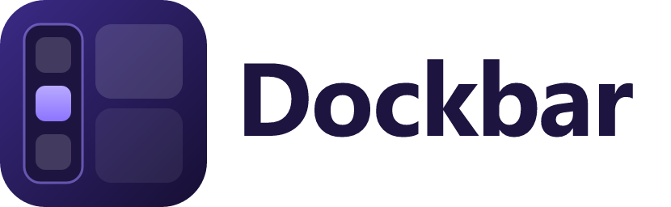
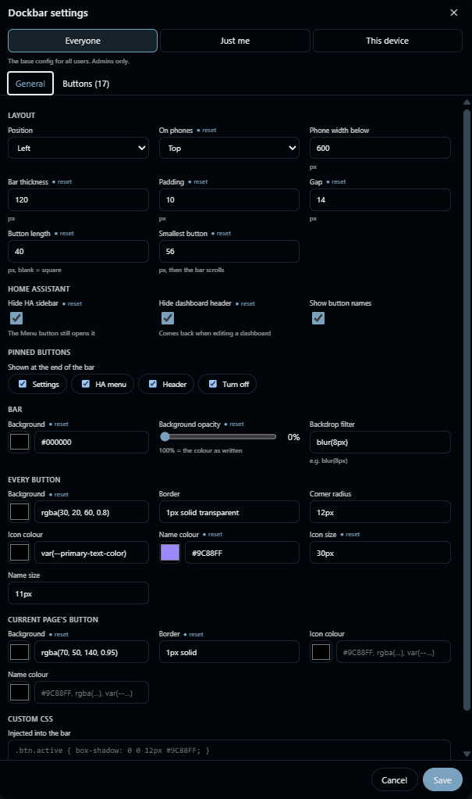
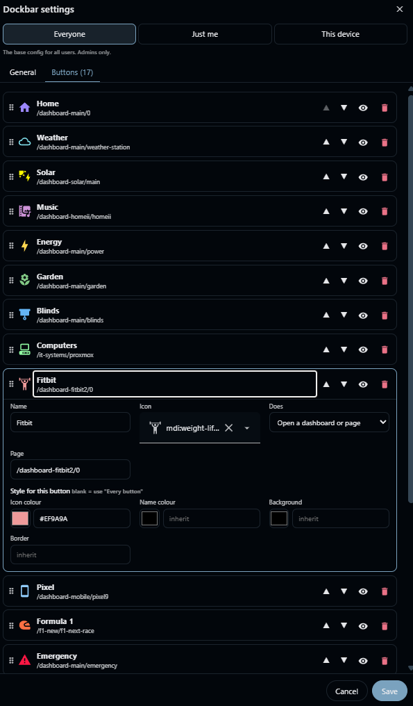

<picture>
  <source media="(prefers-color-scheme: dark)" srcset="custom_components/dockbar/brand/dark_logo.png">
  
</picture>

# Dockbar

A persistent, fully styleable navigation bar for **every** Home Assistant dashboard, on the left, right, top or bottom of the screen.

Dockbar isn't a card. It loads once for the whole frontend, so it stays put when you switch dashboards and needs no per-view setup. It can also hide Home Assistant's own sidebar and dashboard header, each on its own setting.

- Configured in the UI with a live preview, for everyone, per user or per device
- Per-button colours, borders and icons, plus a dashboard and view picker
- Pinned Settings, Menu, Header and Turn off buttons
- Highlights the button for the page you're on
- Live entity values on buttons, e.g. solar power or battery %
- Can be hidden on chosen dashboards, e.g. a wall tablet's kiosk view
- Can move to a different edge on phones
- Reserves its space through HA's own safe-area insets, so pages lay themselves out around it instead of being covered

> Tested on Home Assistant 2026.10.

## Install

Dockbar is a small integration that loads the bar on every page. There's no YAML to edit.

### HACS (custom repository)

1. HACS → ⋮ → **Custom repositories** → add `https://github.com/aistuartai/Dockbar`, type **Integration**.
2. Download **Dockbar** and restart Home Assistant.
3. **Settings → Devices & services → Add integration → Dockbar.** The bar appears straight away.

### Manual

Unzip `dockbar.zip` from the latest [release](https://github.com/aistuartai/Dockbar/releases) into `/config/custom_components/dockbar/`, restart, then add the integration as above.

## Turning it on and off

| How | Effect |
|---|---|
| **`switch.dockbar`** | Shows or hides the bar on every screen instantly. Works in automations, scripts and dashboards. |
| **Settings → Devices & services → Dockbar → ⋮ → Disable** | Stops loading Dockbar. Open screens drop the bar immediately, and HA's sidebar and header come back. Enabling it brings the bar back the same way. |
| **⏻ Turn off** pinned button | This device only. A round button in the bottom-right corner turns it back on. |

## Configure

<p>
  
  
</p>

Click the **⚙ Settings** button pinned at the end of the bar, or add `?dockbar=edit` to any URL. Changes preview live on the bar, and nothing is saved until you click **Save**.

### Three levels

| Level | Who can edit | Stored in | Applies to |
|---|---|---|---|
| **Everyone** | Admins | HA system data | All users |
| **Just me** | Each user | HA user data | That user, on every device |
| **This device** | Anyone | Browser localStorage | This browser only, e.g. a wall tablet |

Each level stores only what it changes, and the levels stack in that order. A ● next to a setting means it's changed at the level you're editing; click it to reset.

On the **Buttons** tab, drag ⠿ to reorder, 👁 to hide a button from the bar (it stays in the list to show again later), and 🗑 to delete it. Deleting is only offered at the level the button was added; levels above hide it instead, so a user can hide a shared button for themselves without removing it for everyone. A button can also be hidden in YAML with `hidden: true`.

When an admin adds a button for everyone, it still appears for users who've reordered or hidden their own buttons. Changes saved in HA sync live to every open screen.

### Pinned buttons

These sit at the end of the bar. Turn each one on or off in **General → Pinned buttons**.

| Button | Does |
|---|---|
| ⚙ Settings | Opens the settings dialog |
| ☰ Menu | Opens Home Assistant's sidebar |
| ▭ Header | Shows or hides the dashboard header for this session |
| ⏻ Turn off | Turns Dockbar off **on this device**. HA's sidebar and header come back, and a small round button in the corner turns it back on. |

### Button actions

| Action | Needs | Does |
|---|---|---|
| `navigate` (default) | `path` | Opens a dashboard or view. The editor suggests every dashboard and view you can open. |
| `url` | `url` | Opens a link in a new tab |
| `toggle_sidebar` | | Opens HA's sidebar |
| `toggle_header` | | Shows or hides the dashboard header |
| `settings` | | Opens Dockbar settings |
| `disable` | | Turns Dockbar off on this device |

### Starting from YAML (optional)

If `/config/www/dockbar/config.yaml` exists and nothing has been saved under **Everyone** yet, Dockbar uses the file as the shared config. The first time an admin saves under **Everyone**, the file's contents move into HA and the file is ignored from then on.

See [`examples/config.yaml`](examples/config.yaml) for every option.

> ⚠️ Everything in `/config/www` is served at `/local/` **without authentication**. Don't put secrets in the YAML.

| Option | Default | Description |
|---|---|---|
| `position` | `left` | `left`, `right`, `top`, `bottom` |
| `mobile_position` | `bottom` | Position below `mobile_breakpoint`; `none` keeps `position` |
| `mobile_breakpoint` | `600` | Width in px |
| `hide_sidebar` | `false` | Uses HA's "always hidden" sidebar mode; your previous setting is restored when turned off |
| `hide_header` | `false` | Hides the dashboard header (it comes back in edit mode) |
| `size` | `88` | Bar thickness in px |
| `padding`, `gap` | `8` | Spacing in px |
| `button_length` | square | Button length along the bar |
| `button_min_length` | `52` | Buttons shrink to fit down to this, then the bar scrolls |
| `background`, `backdrop_filter` | theme | Bar styling |
| `background_opacity` | as written | 0–100. Fades the background colour, on top of any alpha it already has. The editor shows it as a slider. |
| `show_names` | `true` | Show labels under icons |
| `hide_on` | none | Paths where the bar is hidden, e.g. `/wall-panel` (all its views) or `/wall-panel/kiosk`. HA's sidebar and header settings still apply there. |
| `footer` | all four | Pinned buttons: any of `settings`, `menu`, `header`, `off` |
| `defaults` | theme | Style for every button |
| `active` | primary border | Style applied on top of the current page's button |
| `style` | | Raw CSS inside the bar's shadow root |

**Button style keys** (in `defaults`, `active`, or on a button): `background`, `border`, `border_radius`, `icon_color`, `name_color`, `icon_size`, `font_size`, `state_color`.

**Live values:** give a button `entity: sensor.pv_power` to show its state under the name, formatted the way HA shows it (units, translations). Add `attribute: <name>` to show an attribute instead. `state_color` colours the value.

```yaml
- name: Solar
  icon: mdi:solar-power-variant
  path: /dashboard-solar/main
  entity: sensor.pv_power
  state_color: "#FFD54F"
```

## Escape hatches

- `?dockbar=off` in any URL disables Dockbar for that browser session. `?dockbar=on` brings it back, and also undoes the Turn off button on this device.
- `?dockbar=edit` opens the settings dialog, even if the Settings button is hidden.

## Development

```bash
npm install
npm test             # unit tests (Node 24, native TypeScript)
npm run build        # dist/dockbar.js
npm run brand        # re-render the icon and logo PNGs from brand/icon.svg
npm run deploy       # build, then copy custom_components/dockbar into the HA config folder in .deploy-target or $DOCKBAR_DEPLOY_DIR
```

Releases are built by GitHub Actions when a `v*` tag is pushed.

## License

MIT
