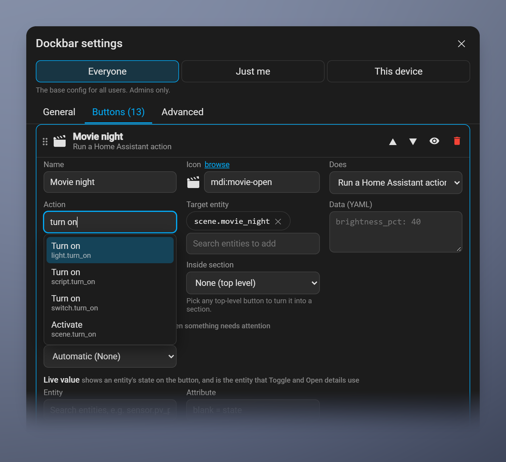

# Looks, YAML and CSS

[← Back to the Dockbar README](https://github.com/aistuartai/Dockbar#readme)

[Using Dockbar](https://github.com/aistuartai/Dockbar/blob/main/docs/using.md) · [Buttons](https://github.com/aistuartai/Dockbar/blob/main/docs/buttons.md) · **Looks, YAML and CSS** · [All settings](https://github.com/aistuartai/Dockbar/blob/main/docs/settings-reference.md) · [Troubleshooting](https://github.com/aistuartai/Dockbar/blob/main/docs/troubleshooting.md) · [How it works](https://github.com/aistuartai/Dockbar/blob/main/docs/how-it-works.md)

Presets and saved looks, the Advanced tab, custom CSS, and starting from a YAML file.

---

## Looks in detail

**General → Look** has the presets to start from. Each one sets the bar and the every-button styles; your buttons, and any colours set on a single button, stay as they are.

**+ Save current look** keeps your current look (bar colours and blur, current-page marker, hover, and the every-button, current-page and badge styles) under a name, as a chip next to the built-in presets. Saved looks belong to the level you're editing: under **Everyone** they're offered to all users, under **Just me** only to you. They appear in the Advanced YAML as `custom_presets`, so you can copy one to share it. A look shared from **Everyone** can't be deleted under **Just me**, but if you change it there, **↺** puts it back to the shared version.

Below the presets: how the current page is marked (fill, line, pill, dot or glow) and its colour, the hover effect, and the button shadow (none, soft, raised, glow, 3D or Soft UI). 3D and Soft UI work out their light and dark edges from each button's own colour, so they suit any colour scheme. Soft UI looks best when the bar and buttons share one mid-to-light or dark-grey colour; on near-black there's no darker shade left for its shadow. The Soft UI shadow is sized from the bar's **Padding**, so it fits in the room around the buttons: at the default padding of 8 it's a tight, subtle shade, and a padding of about 14 or more gives the full, deeper look. Shadows are never clipped at the edge of the buttons; the bar's edge is the limit.

## Advanced: YAML and CSS

The **Advanced** tab shows everything the level you're editing changes, as YAML. Edit anything, including values the other tabs don't offer (for example a shadow of your own like `0 0 20px #9C88FF`), then click **Apply** to preview and **Save** to keep it. Anything invalid is listed and skipped rather than breaking the bar.

Custom CSS goes in the same tab and is injected into the bar. You can target these parts: `bar`, `button`, `active`, `alert`, `badge`, `state`, `children`, `footer`.

  

## Where settings live, and editing them

- **Everyone** is saved in Home Assistant's system storage, **Just me** in your Home Assistant user data, and **This device** in the browser's own storage. None of them is a file you edit by hand. To change them, use the settings dialog, or its **Advanced** tab, which shows the same YAML with **Apply** and **Save**.
- A file in `/config/www/dockbar/config.yaml` is only a starting point, described next. After the first save under Everyone, Dockbar ignores it.

## Starting from YAML (optional)

If `/config/www/dockbar/config.yaml` exists and nothing has been saved under **Everyone** yet, Dockbar uses the file as the shared config. The first time an admin saves under **Everyone**, the file's contents move into HA and the file is ignored from then on.

See [`examples/config.yaml`](https://github.com/aistuartai/Dockbar/blob/main/examples/config.yaml) for every option.

> ⚠️ Everything in `/config/www` is served at `/local/` **without authentication**. Don't put secrets in the YAML.
